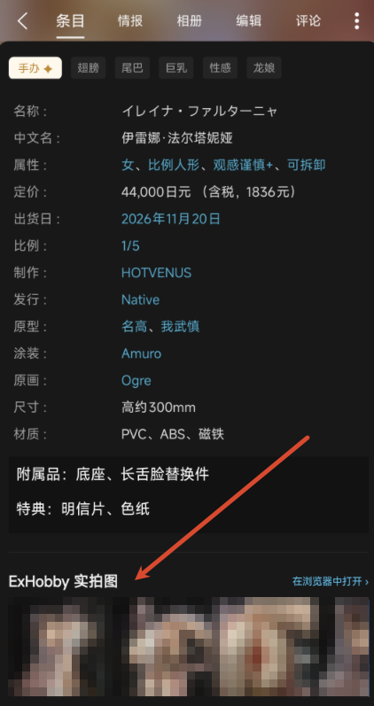

# Hpoi Exhobby Lsposed

在 Hpoi 手办详情页的信息卡下方加一栏「ExHobby 实拍图」：按手办的 hobby id 去
[exhobby.net](https://www.exhobby.net/) 拉该手办的实拍图，点缩略图全屏看原图。

Hpoi 官方图库只有官图，ExHobby 上是玩家实拍，两边内容互补。这个模块把后者直接放进
前者，省得来回搜索。

## 安装

1. 安装 `hpoi-exhobby.apk`。
2. LSPosed → 模块 → 启用「Hpoi ExHobby」。
3. 作用域勾选「Hpoi」（`net.hpoi`）。
4. 强制停止 Hpoi，重新打开，进任意手办详情页。

## 效果

- 手办详情页信息卡下方出现「ExHobby 实拍图」，右边是「在浏览器中打开 ›」，点开就是该手办的 ExHobby 图集页。
- 下方一排横向缩略图，最多 10 张，再多的图去浏览器看，不在 App 里拉。
- 点缩略图全屏看图：双指缩放、双击放大/复位、放大后拖动、未放大时左右滑动切换、单击或返回键退出。
- 全屏页右下角「保存」把当前这张存到相册 `Pictures/ExHobby`，左下角「在浏览器中打开」跳图集页。

## 声明

本项目与 Hpoi、ExHobby 均无关联，仅为个人使用而写的客户端适配。图片与内容版权归
ExHobby 及原作者所有。模块只做展示，不转发、不批量抓取；仅当用户点「保存」时，把那一张
写到系统相册；基于 vibe coding 。
